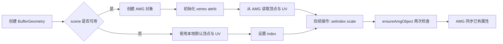

# 1. 问题

BufferGeometry 的构造函数在未创建 scene 的情况下仍继续访问并配置 `this._amgObject`，导致空对象引用风险；同时将引擎对象的属性配置强绑定在构造期，降低了健壮性与可测试性。

## 1.1. **构造期缺少显式空值防护与早返回**
- 位置：`AmazingFeature/js/ThreeJS/wrapper/BufferGeometry.js` 构造函数。
- 现象：当 `getCurrentScene()` 返回空时，仅打印警告，但后续仍对 `this._amgObject` 进行 `vertexAttribs` 与 `submeshes` 操作、并从 `this._amgObject` 读取顶点与 UV 数据。
- 代码示例（问题片段）：
```js
class BufferGeometry {
  constructor() {
    this.userData = {};
    this.attributes = {};
    this.index = null;
    this.translateValue = new Vector3(0, 0, 0);
    const scene = getCurrentScene();
    if (scene) {
      this._amgObject = scene._amgScene.assetMgr.SyncLoad("mesh/Quad.mesh").clone();
    } else {
      console.warn("PlaneGeometry: 无法加载Quad.mesh，scene未创建");
    }
    // 以下代码在 scene 为空时仍会访问 this._amgObject
    var vertexAttribs = this._amgObject.vertexAttribs; // 空引用风险
    var attribDesc0 = new effect.Amaz.VertexAttribDesc;
    // ... 省略推入 vertex attrib 的代码
    const submesh = this._amgObject.submeshes.get(0);
    if (submesh) { submesh.primitive = effect.Amaz.Primitive.TRIANGLES; }

    let vertexData = this._amgObject.getVertexArray(); // 空引用风险
    let uvData = this._amgObject.getUvArray();         // 空引用风险
    // ... 构造 Float32Array 并 initAttribute
  }
}
```
- 影响：在生命周期较早或延迟初始化场景中，构造期会触发运行时异常并中断渲染链路。

## 1.2. **引擎对象配置与几何数据初始化过度耦合在构造函数**
- 位置：同上构造函数中，将 AMG 引擎的 `vertexAttribs`、`submeshes.primitive` 设置与几何顶点/UV 的初始化混在一起执行。
- 问题：
  - 不利于延迟初始化或在测试环境下缺省 scene 时的构造。
  - 难以覆盖“仅几何数据可用、引擎对象稍后再挂载”的测试路径。

## 1.3. **日志信息不一致，降低可维护性**
- 位置：同上。
- 现象：输出为 `PlaneGeometry: ...`，与实际类 `BufferGeometry` 不符，增加阅读与定位成本。

# 2. 收益

通过显式空值防护、早返回与延迟初始化，将构造期的健壮性提升为无异常路径，同时解耦引擎对象配置，便于后续维护与测试。

## 2.1. **消除运行时异常与渲染中断**
- 在无 scene 的环境下不再访问空对象，预期该路径的异常次数降低为 **0**。

## 2.2. **提升可测试性与可维护性**
- 构造与引擎挂载分离后，可分别覆盖“仅几何数据初始化”和“场景可用后同步到 AMG”的用例。

## 2.3. **更清晰的职责边界**
- 几何数据初始化与引擎桥接（AMG）分层，后续在不同平台或替代渲染后端时更易调整。

# 3. 方案

总体思路：在构造期增加显式空值防护与早返回；将 AMG 配置与数据推送下沉到可复用的 `ensureAmgObject` 与 `_initAmgVertexAttribs` 方法，实现延迟初始化与幂等更新。

## 3.1. **构造期增加空值防护与默认数据回退**（解决“构造期缺少显式空值防护与早返回”）

- 关键点：
  - 当 `scene` 不存在时，使用本地默认的 Quad 顶点与 UV 数据进行 `initAttribute`，并设置 `index`，同时标记 `_pendingAmgInit`。
  - 严禁在该分支访问 `this._amgObject`。

- 修改前（节选）：
```js
if (!scene) {
  console.warn("PlaneGeometry: 无法加载Quad.mesh，scene未创建");
}
// 仍继续访问 this._amgObject -> 触发异常
var vertexAttribs = this._amgObject.vertexAttribs;
...
let vertexData = this._amgObject.getVertexArray();
let uvData = this._amgObject.getUvArray();
```

- 修改后（示例实现）：
```js
class BufferGeometry {
  constructor() {
    this.userData = {};
    this.attributes = {};
    this.index = null;
    this.translateValue = new Vector3(0, 0, 0);

    const scene = getCurrentScene();
    if (scene) {
      this._amgObject = scene._amgScene.assetMgr.SyncLoad("mesh/Quad.mesh").clone();
      this._initAmgVertexAttribs();
      this._initDefaultAttributesFromAMG();
    } else {
      console.warn("BufferGeometry: 无法加载 Quad.mesh，scene 未创建");
      this._pendingAmgInit = true;
      this._initDefaultAttributesFallback(); // 本地默认 Quad 顶点/UV + 索引
      return; // 早返回，避免访问空对象
    }
  }

  _initDefaultAttributesFromAMG() {
    const vertexData = this._amgObject.getVertexArray();
    const uvData = this._amgObject.getUvArray();
    const vertices = new Float32Array(vertexData.size() * 3);
    const uvs = new Float32Array(uvData.size() * 2);
    for (let i = 0; i < vertexData.size(); i++) {
      vertices[i * 3] = vertexData.get(i).x;
      vertices[i * 3 + 1] = vertexData.get(i).y;
      vertices[i * 3 + 2] = vertexData.get(i).z;
      uvs[i * 2] = uvData.get(i).x;
      uvs[i * 2 + 1] = uvData.get(i).y;
    }
    this.initAttribute("position", new BufferAttribute(vertices, 3));
    this.initAttribute("uv", new BufferAttribute(uvs, 2));
  }

  _initDefaultAttributesFallback() {
    // 本地 Quad 顶点与 UV，搭配索引形成两个三角形
    const vertices = new Float32Array([
      -0.5, -0.5, 0,  0.5, -0.5, 0,  0.5, 0.5, 0,  -0.5, 0.5, 0
    ]);
    const uvs = new Float32Array([
      0, 0,  1, 0,  1, 1,  0, 1
    ]);
    this.initAttribute("position", new BufferAttribute(vertices, 3));
    this.initAttribute("uv", new BufferAttribute(uvs, 2));
    this.setIndex(new Uint16Array([0, 1, 2, 0, 2, 3]));
  }
}
```

## 3.2. **引入延迟初始化：ensureAmgObject + AMG 配置下沉**（解决“引擎对象配置与几何数据初始化过度耦合在构造函数”）

- 关键点：
  - 新增 `ensureAmgObject()`：在首次需要向 AMG 写入或 scene 刚可用时创建 `this._amgObject`，并同步已存在的几何属性与索引。
  - 将 `vertexAttribs` 与 `submesh.primitive` 的设置下沉到 `_initAmgVertexAttribs()`，只在 AMG 对象可用时执行。
  - 在 `scale`、`setIndex`、`setFromPoints` 等写 AMG 的路径前调用 `ensureAmgObject()`，保证幂等与时序安全。

- 示例实现：
```js
class BufferGeometry {
  ensureAmgObject() {
    if (this._amgObject) return true;
    const scene = getCurrentScene();
    if (!scene) return false;
    this._amgObject = scene._amgScene.assetMgr.SyncLoad("mesh/Quad.mesh").clone();
    this._initAmgVertexAttribs();
    // 将已有几何属性同步到 AMG
    for (const name in this.attributes) {
      const attr = this.attributes[name];
      if (attr && typeof attr.forceUpdateToAMG === 'function') {
        attr.forceUpdateToAMG();
      }
    }
    if (this.index && this._amgObject && this._amgObject.submeshes.get(0)) {
      const sm = this._amgObject.submeshes.get(0);
      sm.indices16 = this.index;
      sm.indicesCount = this.index.length;
    }
    return true;
  }

  _initAmgVertexAttribs() {
    if (!this._amgObject) return;
    const vertexAttribs = this._amgObject.vertexAttribs;
    const attribDesc0 = new effect.Amaz.VertexAttribDesc;
    attribDesc0.semantic = effect.Amaz.VertexAttribType.POSITION_OFFSET;
    attribDesc0.bindingIndex = 0;
    attribDesc0.offset = 36;
    attribDesc0.componentCount = 3;
    vertexAttribs.pushBack(attribDesc0);

    const attribDesc1 = new effect.Amaz.VertexAttribDesc;
    attribDesc1.semantic = effect.Amaz.VertexAttribType.TEXCOORD1;
    attribDesc1.bindingIndex = 0;
    attribDesc1.offset = 48;
    attribDesc1.componentCount = 2;
    vertexAttribs.pushBack(attribDesc1);

    this._amgObject.vertexAttribs = vertexAttribs;
    const submesh = this._amgObject.submeshes.get(0);
    if (submesh) submesh.primitive = effect.Amaz.Primitive.TRIANGLES;
  }

  setIndex(index) {
    this.index = index;
    this.ensureAmgObject();
    if (this._amgObject && this._amgObject.submeshes.get(0)) {
      const sm = this._amgObject.submeshes.get(0);
      sm.indices16 = index;
      sm.indicesCount = index.length;
    }
    return this;
  }

  setFromPoints(points) {
    // ... 原有校验与 positions 构造
    this.initAttribute("position", new BufferAttribute(new Float32Array(positions), 3));
    this.ensureAmgObject();
    if (this._amgObject && this._amgObject.submeshes.get(0)) {
      const sm = this._amgObject.submeshes.get(0);
      sm.primitive = effect.Amaz.Primitive.Points;
      let list = new effect.Amaz.UInt16Vector;
      for (let i = 0; i < points.length; i++) list.pushBack(i);
      sm.indices16 = list;
      sm.indicesCount = points.length;
    }
    return this;
  }

  scale(x, y, z) {
    const positionAttribute = this.attributes.position;
    if (!positionAttribute) return this;
    const positions = positionAttribute.array;
    for (let i = 0; i < positions.length; i += 3) {
      positions[i] *= x; positions[i + 1] *= y; positions[i + 2] *= z;
    }
    this.ensureAmgObject();
    if (this._amgObject) {
      const vertexCount = positions.length / 3;
      const buffer = new effect.Amaz.FloatVector;
      for (let i = 0; i < vertexCount; i++) {
        buffer.pushBack(positions[i * 3]);
        buffer.pushBack(positions[i * 3 + 1]);
        buffer.pushBack(positions[i * 3 + 2]);
      }
      this._amgObject.setAttributeData(effect.Amaz.VertexAttribType.POSITION, buffer, 0, vertexCount);
    }
    return this;
  }
}
```

## 3.3. **日志信息修正**（解决“日志信息不一致，降低可维护性”）
- 将 `PlaneGeometry: 无法加载Quad.mesh，scene未创建` 修正为 `BufferGeometry: 无法加载 Quad.mesh，scene 未创建`，统一类名与文案。

## 3.4. **流程示意（创建与延迟挂载）**

- 说明：图示展示了构造期在 scene 缺失与存在两种路径的差异，以及后续操作通过 `ensureAmgObject` 实现延迟挂载与数据同步的流程。

# 4. 回归范围

本次修改影响 BufferGeometry 的构造与引擎对象的挂载时序。需要从端到端的渲染流程视角进行回归，覆盖“scene 不可用/可用”的两条主路径，以及后续属性与索引写入时的同步行为。

## 4.1. 主链路
- 场景尚未创建时构造 BufferGeometry：
  - 预置默认顶点/UV 与索引成功，未访问 AMG；无异常。
- 场景创建后执行 `scale`/`setIndex`/`setFromPoints`：
  - `ensureAmgObject` 触发 AMG 创建与同步；渲染正常。
- 场景已创建时构造 BufferGeometry：
  - 从 AMG 读取顶点/UV，正常初始化；后续操作不受影响。

示例用例要点：
- 预置条件：`getCurrentScene()` 返回空/非空两种情况。
- 操作步骤：构造 -> `scale` -> `setIndex` -> `dispose`。
- 期望结果：无异常；当 scene 可用时 AMG 获得同步的顶点与索引数据。

## 4.2. 边界情况
- 重复调用 `ensureAmgObject`：应幂等，不重复创建对象。
- 在 scene 仍不可用时调用 `setAttribute`/`setIndex`：仅更新本地几何数据，不写 AMG；无异常。
- 调用 `dispose` 后再调用 `ensureAmgObject`：应返回 false 或不进行任何创建；无资源泄漏。
- BoxGeometry / CylinderGeometry / SphereGeometry 等子类：
  - 验证其在 super() 后的行为在 scene 缺失/存在两种情况下均无异常，尤其是依赖默认 Quad 的 `CylinderGeometry.scale(...)` 路径。
